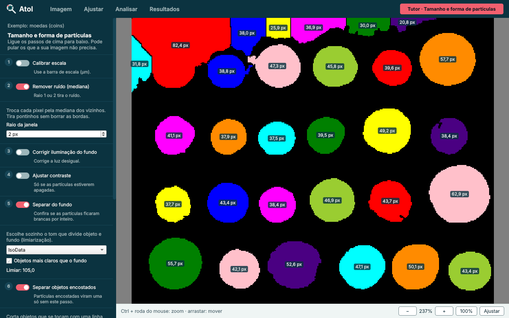
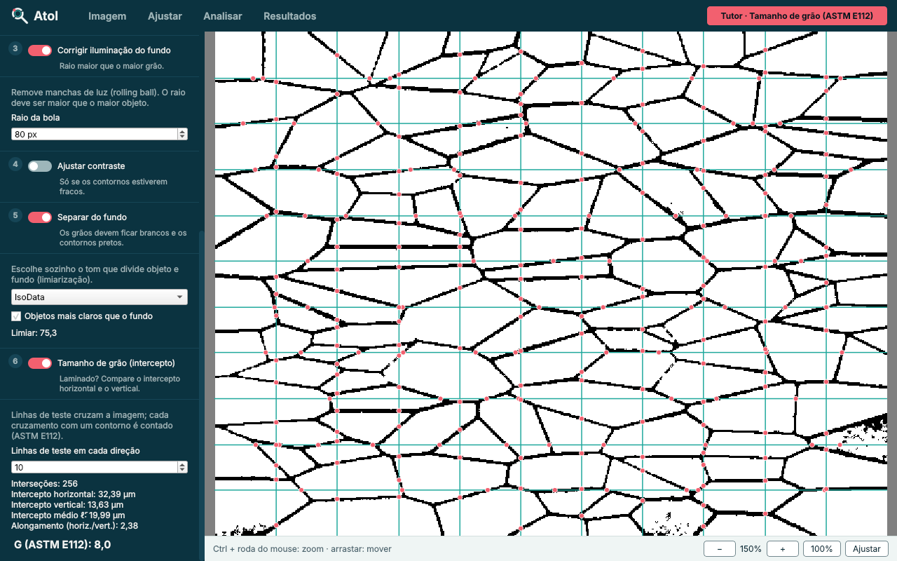

# Atol: scientific image analysis for beginners

**Atol** is a desktop program for quantitative image analysis aimed at students who have never used ImageJ/Fiji. It covers the most common measurements in materials and mechanical engineering (phase fraction and porosity, particle size and shape, grain size, Vickers hardness), guides the user through each analysis with step-by-step tutors, and explains the physics and mathematics behind every tool on hover.

The core algorithms were validated against **ImageJ 1.54p** (the engine of Fiji) and against the **ASTM E112** tables.

> **Status: alpha (v0.9.0a1).** The core is validated and tested; the interface is being tested with real laboratory images and students. Interface and comments are in Portuguese.



## Goal

1. Give beginners a short path from a micrograph to a number: each analysis is a guided list of steps, and every step explains what it does and why.
2. Produce results that can be trusted: the same threshold, counts, areas, perimeters and watershed cuts as ImageJ.
3. Produce outputs ready for a paper: SciencePlots figures and tables in journal style (Excel export included).

## Features

| Menu | Tool | Method |
|---|---|---|
| Image | Spatial calibration | two clicks on a known length; $L = L_{px}/s$, $A = A_{px}/s^2$ |
| Image | Distance, angle and **Vickers hardness** | Pythagoras, `atan2`, $HV = 1.8544\,F/d^2$ |
| Adjust | Noise removal | median filter (disk) |
| Adjust | Background correction | rolling ball (Sternberg, 1983) |
| Adjust | Contrast | linear gain with saturation |
| Analyse | Thresholding | IsoData (Ridler & Calvard, 1978) / Otsu (1979) |
| Analyse | Split touching objects | watershed on the distance transform, h-maxima seeds |
| Analyse | **Grain size** | Heyn lineal intercept, ASTM E112 |
| Analyse | Object counting | connected components (8-connectivity) |
| Results | Table, histogram, area fraction, Excel | per-object area, perimeter, equivalent diameter, circularity |
| Tutor | Guided analyses | porosity · particles · grain size · Vickers · cell counting |

## Method (highlights)

**Perimeter.** Summing pixel edges overestimates the perimeter of a circle by about $4/\pi \approx 1.27$. Atol traces the outer boundary along pixel edges and subtracts $(2-\sqrt{2})$ per corner, the same estimator used by ImageJ (`PolygonRoi.getTracedPerimeter`). Circularity is then $C = 4\pi A/P^2$, capped at 1.

**Watershed.** The distance transform $D(p) = \min_{q \in \text{background}} \lVert p - q \rVert$ turns each object centre into a peak. Only peaks with prominence $D_{peak} - D_{saddle} \geq h$ become seeds, which avoids splitting a single object with a serrated edge. With $h = 0.7$ px the cuts match ImageJ's *Binary › Watershed*.

**Grain size.** Test lines are drawn horizontally and vertically; each crossing with a grain boundary is counted. The mean intercept and the ASTM grain size number are

$$
\bar{\ell} = \frac{L}{P}, \qquad G = -6.6439\,\log_{10}\bar{\ell}_{\,\mathrm{mm}} - 3.288
$$

and the ratio $\bar{\ell}_{h}/\bar{\ell}_{v}$ measures grain elongation (e.g. in rolled samples).

**Vickers hardness.** From the two diagonals of the indentation, $HV = 2F\sin(68^\circ)/d^2$ with $d = (d_1 + d_2)/2$. Since $d$ is squared, a 5 % error on the diagonal gives about 10 % error on $HV$, so the tutor asks the user to zoom before clicking.



## Validation

| Test | Reference | Atol |
|---|---|---|
| Blobs: count, areas | ImageJ 1.54p (*Analyze Particles*) | 64 objects, identical areas |
| Blobs: perimeters | ImageJ 1.54p | 49/64 identical, all within one corner (0.586 px) |
| Coins: count | ImageJ 1.54p | 96 = 96 |
| Watershed, Blobs | ImageJ *Binary › Watershed* | 64 → 68, same objects cut |
| Grain size, stripes | exact value | $\bar{\ell}$ = 20.0 and 13.0 px (exact) |
| Grain size number | ASTM E112 table | G = 0.0 / 8.0 / 10.0 for $\bar{\ell}$ = 0.320 / 0.020 / 0.010 mm |
| Rolled grains (noise + uneven light) | drawing ground truth | 3–7 % error with background correction |
| Vickers | hand calculation | 216.0 HV10 for d = 0.293 mm |

All of these are automated in [`tests/test_atol.py`](tests/test_atol.py) (19 tests, ~3 s). Full report: [`validacao/RELATORIO.md`](validacao/RELATORIO.md).

## Install and run

```bash
git clone https://github.com/oliveirajfm21-blip/Atol.git
cd Atol
pip install -r requirements.txt
python main.py        # opens Atol with a sample image
pytest                # runs the validation tests
```

Requires Python ≥ 3.10. LaTeX is **not** needed (SciencePlots runs in `no-latex` mode).

## Project structure

```
Atol/
├── main.py              entry point
├── atol/
│   ├── nucleo/          scientific core (NumPy, SciPy, scikit-image; no GUI)
│   ├── saida/           Excel export and SciencePlots figures
│   ├── tutor/           guided analyses (data only)
│   ├── interface/       PySide6 GUI
│   └── ajuda/           help cards: texts, formulas and figures
├── tests/               pytest suite with the validated numbers
├── validacao/           sample images, ImageJ outputs and report
└── docs/                technical documentation (Portuguese)
```

Dependencies only point downwards (`interface → tutor, saida → nucleo`): the scientific core can be tested and reused without the GUI. Details in [`docs/ARQUITETURA.md`](docs/ARQUITETURA.md).

## Roadmap

- Tests with real micrographs from the laboratory and with students (usability study).
- Tutor warnings (inverted lookup table, over-segmentation).
- Add-on packages and two editions on start-up: **Atol Material** and **Atol Life**.

## Author

João Filipe M. de Oliveira, developed for the laboratory of Prof. Dr. Gilberto Prandi (Unicamp, Brazil).
